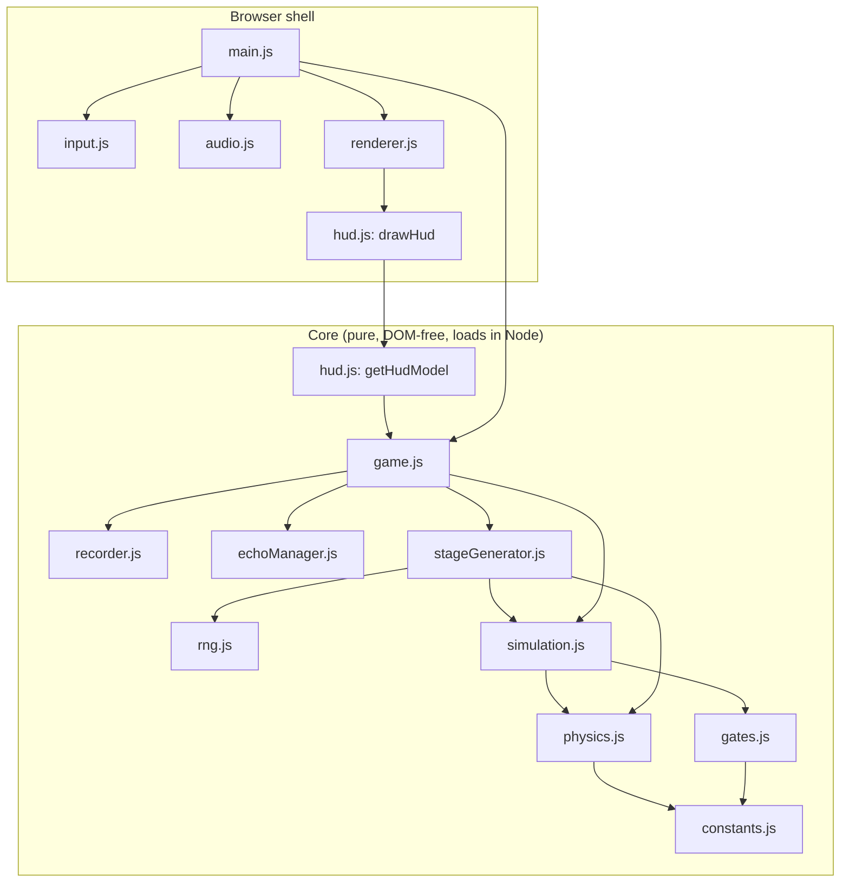
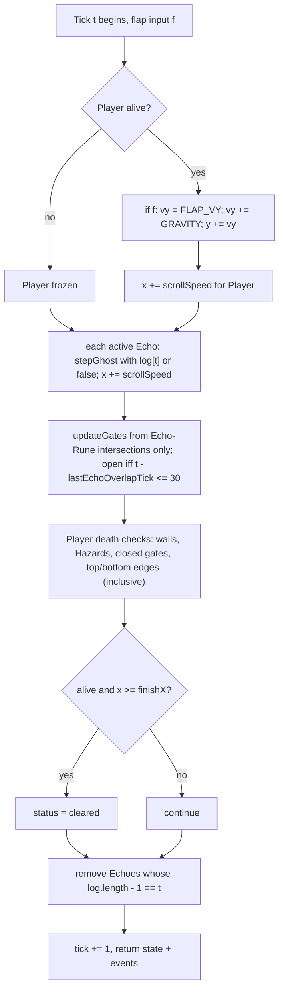
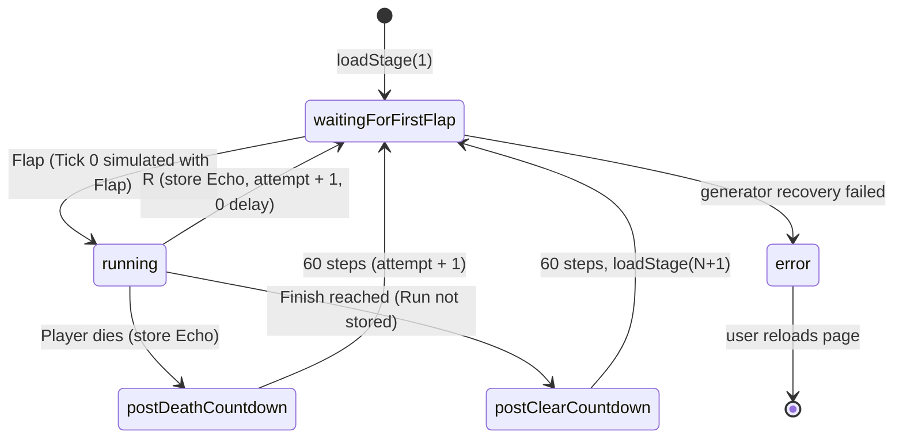

# Design Document: Ghostly Echoes

## Overview

Ghostly Echoes is a stage-based, side-scrolling flap game built on plain HTML5 canvas and vanilla JavaScript. Every Run that ends in death or a manual restart (R) becomes an Echo that replays its recorded flap inputs from Tick 0. Echoes, and only Echoes, hold Runes that open linked Rune_Gates for the live Player.

The design rests on three decisions:

1. **Pure, integer, deterministic core.** The Simulation, Recorder, Echo_Manager, Stage_Generator and Seeded_RNG are pure JavaScript with no DOM access. State uses integer fixed-point values (1/256 px), so a Run is a pure function of `(course, inputLog)`. Recording an Echo therefore means storing only its flap booleans (Requirements 1, 3, 4).
2. **Thin browser shell.** `input.js`, `audio.js`, `renderer.js`, `hud.js` (drawing half) and `main.js` adapt browser APIs to the core. `game.js` holds the Game state machine (waiting, running, Countdowns) and is also DOM-free, so it can be tested headlessly.
3. **Construction-based Stage generation.** The Stage_Generator first creates the Solution_Witness inputs with a deterministic steering controller. It simulates them headlessly and then places walls, Hazards, Runes and Rune_Gates around the simulated paths. A `selfCheck` verifies the result. There is no candidate-retry loop (A15, 9.8 to 9.12).

### Research Findings

- **Classic scripts vs ES modules over `file://`.** Browsers load module scripts in CORS mode. A page opened from `file://` has an opaque origin, so `<script type="module">` imports fail in Chrome and other browsers. Classic `<script src>` elements load fine. Sources: [MDN: JavaScript modules](https://developer.mozilla.org/en-US/docs/Web/JavaScript/Guide/Modules) (see the "local testing" troubleshooting note) and [MDN: CORS errors](https://developer.mozilla.org/en-US/docs/Web/HTTP/CORS/Errors). Decision: classic scripts, with each core file exporting through a guarded UMD-style pattern (A17, 11.2, 11.8).
- **Fixed timestep with an accumulator.** Glenn Fiedler's ["Fix Your Timestep!"](https://gafferongames.com/post/fix_your_timestep/) separates simulation steps from render frames. Real elapsed time goes into an accumulator, fixed `dt` steps are consumed from it, and the step count per frame is capped to avoid the "spiral of death". Decision: 60 Ticks/s, at most 5 Ticks per frame, and any excess is discarded (1.7, 1.8).
- **Seeded PRNG and seed mixing.** mulberry32 is a small 32-bit generator with a full 2^32 period over its state and good statistical quality for games ([bryc, PRNG shootout](https://github.com/bryc/code/blob/master/jshash/PRNGs.md)). MurmurHash3's `fmix32` finalizer is a bijection on 32-bit integers ([MurmurHash3 reference](https://github.com/aappleby/smhasher/blob/master/src/MurmurHash3.cpp)). Decision: `deriveSeed` is built from `fmix32`, so stage seeds are pairwise distinct (9.5).
- **Integer determinism in JS.** `Math.imul`, `>>> 0` and `| 0` give exact 32-bit integer arithmetic, and JS Numbers represent all integers exactly up to 2^53. With integer fixed-point state, results do not depend on the browser's floating-point behavior ([MDN: Math.imul](https://developer.mozilla.org/en-US/docs/Web/JavaScript/Reference/Global_Objects/Math/imul)) (A14, 1.4).
- **`HTMLMediaElement.play()` returns a Promise.** The Promise rejects with `NotAllowedError` when autoplay policy blocks playback, and with `NotSupportedError` when the source fails ([MDN: play()](https://developer.mozilla.org/en-US/docs/Web/API/HTMLMediaElement/play), [Chrome autoplay policy](https://developer.chrome.com/blog/autoplay/)). Decision: every `play()` call gets a `.catch` plus a try/catch, and audio is unlocked on the first user gesture (7.9).
- **Tinting sprites.** With `globalCompositeOperation = 'source-atop'`, a fill paints only where pixels already exist, so it tints the sprite's silhouette ([MDN: globalCompositeOperation](https://developer.mozilla.org/en-US/docs/Web/API/CanvasRenderingContext2D/globalCompositeOperation)). This happens on an offscreen canvas per tint, and nothing is ever read back with `getImageData` (4.7, 4.8, 11.3).
- **Node's built-in test runner.** `node --test` with `node:test` and `node:assert/strict` ships with Node 18 and later and needs no packages ([Node.js test runner docs](https://nodejs.org/api/test.html)) (12.1).

Content was rephrased for compliance with licensing restrictions.

## Architecture

### Module Diagram



### File Layout

```
index.html                  canvas + classic <script> tags in dependency order
src/constants.js            all tunables (FP, sizes, physics, difficulty table, styles)
src/rng.js                  mulberry32, fmix32, deriveSeed, stageSeed
src/physics.js              stepGhost, hitbox, rectsIntersect (inclusive)
src/gates.js                updateGates (Echo hitboxes only), isGateOpen
src/recorder.js             begin / append / finalize (frozen logs)
src/echoManager.js          pure bounded FIFO (max 3) with tint indices
src/simulation.js           createRunState, stepSimulation, replayHeadless
src/stageGenerator.js       steering controller, witnesses, placement, selfCheck
src/game.js                 Game state machine, Countdowns, attempts, stages
src/hud.js                  getHudModel (pure) + drawHud (canvas)
src/input.js                keyboard / mouse / touch -> flap queue, restart flag
src/renderer.js             course, ghosts, tints, gates, fallback rectangle
src/audio.js                safe jump / game-over playback
src/main.js                 rAF loop, advanceAccumulator, wiring, visibilitychange
tests/helpers/property.js   forAll harness (seeded, ~500 cases, reproducible)
tests/helpers/load.js       loads core scripts in Node via require
tests/*.test.js             property, example and smoke tests
```

`index.html` loads scripts in this order: constants, rng, physics, gates, recorder, echoManager, simulation, stageGenerator, game, hud, input, audio, renderer, main.

### Guarded Export Pattern (UMD-style)

Every core file wraps its body in the same IIFE. In the browser it attaches to `globalThis.GhostlyEchoes`. In Node it also sets `module.exports`. Core files look up dependencies from the shared namespace and fall back to `require` in Node:

```js
(function (root, factory) {
  var ns = (root.GhostlyEchoes = root.GhostlyEchoes || {});
  var deps = typeof module === 'object' && module.exports
    ? { constants: require('./constants.js'), physics: require('./physics.js') }
    : { constants: ns.constants, physics: ns.physics };
  var api = factory(deps);
  ns.gates = api;
  if (typeof module === 'object' && module.exports) module.exports = api;
})(typeof globalThis !== 'undefined' ? globalThis : this, function (deps) {
  'use strict';
  // ... pure functions only, no window/document/canvas access ...
  return { updateGates: updateGates, isGateOpen: isGateOpen };
});
```

Both environments get the same functions (11.8, 12.2). Core files never mention `window`, `document`, `Math.random`, `Date` or `performance`. A smoke test checks this with a source scan (1.2, 1.6).

### Per-Tick Order (stepSimulation)



This order implements 2.4, 2.5, 4.2, 6.11, 6.13, 7.1 to 7.3, 7.6 and 9.1 (death checks run before the finish check), plus 4.4 (an Echo is removed after its last recorded Tick).

### Game State Machine (outside the Simulation)



- In both Countdowns, Flap and R are ignored. The Simulation is not stepped, the Tick counter does not move and no log entry is appended (8.2, 8.10).
- R is ignored while waiting for the first Flap (8.5). Only non-repeat R keydowns count (8.4).
- `loadStage` resets attempt to 1, clears Echoes and generates the Course (9.3, 9.4, A6).

### Frame Accumulator

`main.js` exports a pure helper:

```js
// TICK_MS = 1000 / 60; MAX_TICKS_PER_FRAME = 5
function advanceAccumulator(accMs, elapsedMs) {
  var total = accMs + Math.max(0, elapsedMs);
  if (total > MAX_TICKS_PER_FRAME * TICK_MS + EPS) return { ticks: MAX_TICKS_PER_FRAME, accMs: 0 }; // 1.8
  var ticks = Math.floor((total + EPS) / TICK_MS);
  return { ticks: ticks, accMs: Math.max(0, total - ticks * TICK_MS) };                           // 1.7
}
```

`EPS = 1e-6` absorbs floating-point error at exact tick boundaries. The accumulator only decides how many fixed steps run in a frame. Each step consumes `log[tick]`, so the Simulation state sequence does not depend on frame timing (1.10, P2). Each fixed step calls `game.fixedStep(input)`, which also drives Countdown steps.

## Components and Interfaces

### constants.js

Units: `FP = 256`, so 1 px = 256 units. Positions and velocities are integer FP units. Ghost `x`/`y` is the hitbox's top-left corner.

| Constant | Value | Notes |
|---|---|---|
| `COURSE_W`, `COURSE_H` | 800, 480 px | viewport / Course height |
| `PLAYER_W`, `PLAYER_H` | 32, 32 px | Ghost hitbox |
| `PLAYER_START_X`, `PLAYER_START_Y` | 120, 224 px | Tick-0 state, `vy = 0` |
| `GRAVITY` | 64 FP/Tick² | 0.25 px/Tick² |
| `FLAP_VY` | −1280 FP/Tick | −5 px/Tick |
| `SCROLL_SPEED` | 768 FP/Tick | 3 px/Tick, same for all Stages |
| `GATE_HOLD_TICKS` | 30 | A4 |
| `MAX_ECHOES` | 3 | 5.2 |
| `COUNTDOWN_STEPS` | 60 | A16 |
| `MAX_TICKS_PER_FRAME` | 5 | 1.8 |
| `BASE_SEED` | `0x6E05C40D` | fixed constant (9.5) |
| `RUNE_W`, `RUNE_H` | 32, 32 px | |
| `GATE_W` | 24 px | |
| `WALL_W` | 48 px | regular column width |
| `HAZARD_SIZE` | 24 px | |
| `RUNE_GAP_MIN` | `PLAYER_W + 4` = 36 px | gate left − rune right, Requirement 6.1 |
| `RUNE_GAP_MAX` | `30 × 3 − GATE_W` = 66 px | so gate right − rune right ≤ 30 × scroll speed (6.1) |
| `STEER_BIAS` | 57 px | steering offset |
| `MIDLINE_CLEARANCE_PX` | 100 px | gate/Rune targets vs midline 240 px |
| `PASSAGE_PAD` | 12 px | |
| `APPROACH_PX` | 420 px | approach zone before each gate column |
| `RUNWAY_PX` | 400 px | before the first column |
| `FINISH_MARGIN_PX` | 200 px | |
| `ECHO_ALPHA` | 0.45 | inside 30–60 % (4.7) |
| `ECHO_TINTS` | `['#5ec8ff', '#ffb347', '#b78cff']` | |
| `RUNE_STYLES` | `[{symbol:'◆',color:'#ff5ea8'}, {symbol:'▲',color:'#59e38c'}, {symbol:'●',color:'#ffd84d'}]` | one per pair (6.9) |

**Difficulty table.** With `k = min(stage − 1, 19)` and `lerp(a, b) = a + trunc((b − a) · k / 19)`:

| Parameter | Stage 1 | Stage 20+ (limit) | Rule |
|---|---|---|---|
| `gapPx` | 200 | 120 | non-increasing, limit 120 ≥ 2 × 32 (9.11) |
| `spacingPx` | 520 | 380 | non-increasing |
| `hazardPerMille` | 0 | 600 | non-decreasing |
| `gateCount` | 1 | 3 | `min(3, 1 + trunc(2k / 13))`: Stages 1–7 → 1, 8–13 → 2, 14+ → 3 |

All four are monotone and fixed from Stage 20 on (9.7).

### rng.js

```js
fmix32(h)                 // MurmurHash3 finalizer, bijective on uint32
deriveSeed(a, b)          // fmix32((a ^ fmix32((b + 0x9E3779B9) >>> 0)) >>> 0)
stageSeed(base, stage, salt = 0)  // salt 0: deriveSeed(base, stage); else deriveSeed(deriveSeed(base, stage), salt)
createRng(seed)           // mulberry32; seed coerced with >>> 0 (range 0..2^32-1, 1.2)
  .nextU32() -> uint32
  .nextInt(lo, hi) -> integer in [lo, hi] (inclusive), via (nextU32() % (hi - lo + 1)) + lo
  .chance(perMille) -> nextInt(0, 999) < perMille
```

For a fixed `a`, `deriveSeed(a, ·)` is a composition of bijections (add constant, fmix32, xor `a`, fmix32). So different stage numbers always get different seeds (9.5).

### physics.js

```js
stepGhost(g, flap) -> { x, y, vy }        // if flap: vy = FLAP_VY; vy += GRAVITY; y += vy; x += SCROLL_SPEED
hitbox(g) -> { l, t, r, b }               // l = x, t = y, r = x + PLAYER_W*FP, b = y + PLAYER_H*FP
rectsIntersect(a, b) -> boolean           // inclusive: a.l <= b.r && b.l <= a.r && a.t <= b.b && b.t <= a.b
outOfCourse(h) -> boolean                 // h.t < 0 || h.b > COURSE_H*FP
```

Echoes and the Player share `stepGhost`, so the replay round trip holds by construction (4.2, 4.3). `rectsIntersect` is inclusive, so touching an edge counts as contact (7.1, 7.2, 7.6).

### gates.js

```js
updateGates(gates, runes, echoHitboxes, tick) -> gates'   // echoHitboxes ONLY, the Player is never passed in (6.13)
isGateOpen(gate, tick) -> boolean   // gate.lastEchoOverlapTick !== null && tick - gate.lastEchoOverlapTick <= GATE_HOLD_TICKS
```

For each gate `i`, if any Echo hitbox intersects `runes[i]` at `tick`, then `lastEchoOverlapTick = tick`. `open = isGateOpen(gate, tick)`. This gives 6.2 to 6.5 and 6.8 directly. The open window covers `[last, last + 30]`, a new overlap restarts it, and the initial `null` means "no overlap before the Run" (closed at Tick 0). The function signature has no Player argument, which makes 6.13 hold structurally.

### recorder.js

```js
createRecorder() -> { begin(), append(flag), finalize() -> FrozenLog | null, isRecording() }
```

- `begin()` starts a fresh empty array (3.1). `append` pushes exactly one boolean per simulated Tick and does nothing while not recording (3.2, 3.5, 3.6).
- `finalize()` stops recording and returns `Object.freeze(array)`. It returns `null` for zero-length logs (3.3, 3.4, 3.7, 3.8, 4.10).

### echoManager.js (pure)

```js
emptyEchoes() -> []
storeEcho(echoes, log) -> echoes'        // log must be non-null
// entry: { log, tintIndex, seq }
```

`storeEcho` drops `echoes[0]` if the length is 3, then appends `{ log, tintIndex, seq: lastSeq + 1 }`. `tintIndex` is the smallest index in `{0,1,2}` not used by the retained entries. Order goes oldest to newest. Logs are kept by reference, and they are frozen (5.1 to 5.5, 5.8). The tint set never changes during a Run, so tints are stable and distinct (4.8).

### simulation.js

```js
createRunState(course, echoes) -> RunState     // Player and every Echo at the Tick-0 start state (4.1, 8.7)
stepSimulation(course, state, flap) -> { state, events }   // pure, returns a new state object
replayHeadless(course, playerLog, echoLogs, opts?) -> { states, outcome, deathTick?, clearTick? }
```

`stepSimulation` follows the per-Tick order diagram. `events` is `{ flapped, died, cleared }`. `flapped` is true only when the Player was alive and `flap` was true, which feeds `jump.wav` (7.5). `died` is set at most once per Run, which feeds `game_over.wav` exactly once (7.4). After death, further steps leave the Player unchanged (7.8). `replayHeadless` treats missing log entries as `false` (1.9). It stops at clear, at death, or at `opts.maxTicks` (default: `playerLog.length`, or the clear tick when `opts.untilEnd`).

### stageGenerator.js

```js
difficulty(stage) -> { gapPx, spacingPx, hazardPerMille, gateCount }
steer(ghost, targetYpx) -> boolean
generateStage(stage, opts?) -> Course     // opts: { seedSalt = 0, paramsOverride }
selfCheck(course)                         // throws GeneratorError
checkRunePlacement(course) -> void        // throws GeneratorError
class GeneratorError extends Error { stage, seed, reason }
```

Generation runs in this order (9.8). Witness inputs are chosen and simulated before any geometry exists:

1. **Seed and params.** `seed = stageSeed(BASE_SEED, stage, seedSalt)`, `rng = createRng(seed)`, and `params = paramsOverride ?? difficulty(stage)` with `gateCount` always taken from `difficulty(stage)`.
2. **Skeleton (x only).** From `x0 = PLAYER_START_X + RUNWAY_PX`: for each gate `k`, add 2 regular columns spaced `spacingPx` apart, then an approach zone of `APPROACH_PX`, then the gate column (`GATE_W` wide, walls above/below its passage). After the last gate add 2 regular columns. `finishX = lastColumnRight + FINISH_MARGIN_PX`. Stage 1 is about 2,900 px (~930 Ticks). Stage 20+ is about 5,000 px (~1,600 Ticks), well under 3,600.
3. **Targets (RNG).** Each passage target `cy` is in `[gapPx/2 + 16, H − gapPx/2 − 16]`. For gate `k`, the RNG picks a half. The gate `cy` must also be ≥ 100 px from the midline 240 in that half. The Rune target `ry_k` is in the opposite half, in `[80, 140]` (upper) or `[340, 400]` (lower), which is also ≥ 100 px from the midline. With `gapPx = 200` the feasible gate `cy` ranges are **116..140** (upper) and **340..364** (lower). With `gapPx = 120` they are 76..140 and 340..404.
4. **Steering controller (pure).** `steer(g, targetY)` flaps iff `(g.y + 16·FP + 8·g.vy) > (targetY + STEER_BIAS)·FP`, using the predicted hitbox center 8 Ticks ahead. Without the bias, the controller hovered 34 to 81 px above its target (measured with these constants). `STEER_BIAS = 57` is tuned so the hover band is roughly centered on the target, at about −26 to +22 px. The target is the `cy` of the next column ahead and switches once the hitbox left edge passes the previous column's right edge.
5. **Player witness.** Tick 0 is always a Flap (`log[0] = true`), as in every real Run, where the first Flap starts the Run on Tick 0 (8.9). From Tick 1 on, run `steer` + `stepGhost` until `x ≥ finishX`, recording flaps. That is the Player Input_Log.
6. **Echo witness k.** Divergence Tick `D_k` is the first Tick on which the witness hitbox left edge passes the right edge of the last regular column before gate `k`'s approach zone. Echo `k` uses the same controller, so its log equals the Player log on `[0, D_k)`. `D_k ≥ 1` always (asserted), so every Echo log also starts with the Tick-0 Flap. From `D_k` on, its target is `ry_k`.
   - **Rune x first.** `runeGap = rng.nextInt(RUNE_GAP_MIN, RUNE_GAP_MAX)`, `runeRight = gateLeft − runeGap`, `runeLeft = runeRight − RUNE_W`.
   - **Simulate**, then **place the Rune from the simulated path.** The crossing Tick `c_k` is the first Tick on which the Echo hitbox center x ≥ the Rune's horizontal center. The Rune is centered vertically on the Echo hitbox center at `c_k`. `ry_k` is only the steering target. Refinement: let `E_k` be the last Tick with Echo hitbox left ≤ `runeRight` (horizontal exit). If the Echo at `E_k` would not vertically intersect the Rune, shift the Rune center the minimal amount toward the Echo center at `E_k` (at most 31 px from it). `E_k − c_k` is about 11 Ticks and `|vy| ≤ 5 px/Tick`, so the shift never exceeds 64 px. This keeps the Echo intersecting the Rune until it leaves horizontally, which is the precondition of P9.
   - **Truncate.** Once the Rune is placed, `L_k` is the last Tick the Echo hitbox intersects the placed Rune (`= E_k` after the refinement). The Echo log is truncated to `L_k + 1` entries. This is "press R once you are past the Rune" (A18, 10.7).
   - **Why the Echo stays alive through `L_k`.** At `L_k` its right edge ≤ `runeRight + PLAYER_W < gateLeft` because `runeGap ≥ RUNE_GAP_MIN`, so it never reaches gate `k`'s column. On `[0, D_k)` it shares the Player's path, and every earlier passage is built around all alive witness hitboxes. The approach zone has no walls, and Hazards avoid all alive witness hitboxes. Gates `j < k` on its prefix are opened by Echoes `1..k−1`, so Echo `k`'s survival depends on the earlier Echoes (9.9).
   - **Half rule on the actual path.** The hover band (−26..+22) and the Rune shift (≤ 31 px from a band point) put the Rune center within `ry_k − 57 .. ry_k + 53`, which is ≤ 193 or ≥ 283 px. The gate passage center is the midpoint of the Player witness extents in the gate column, so it is within `cy − 26 .. cy + 22`: ≤ 162 or ≥ 314 px. So the 6.1 opposite-half rule holds for the placed geometry, not only for the targets. `checkRunePlacement` verifies it anyway.
7. **Placement.** For each column, the passage is `[minTop − PASSAGE_PAD, maxBottom + PASSAGE_PAD]` over all alive witness hitboxes (Player and untruncated Echo prefixes) whose x-span intersects the column x-span. It is widened symmetrically to ≥ `gapPx`, then shifted (not shrunk) into `[0, H]`. Walls fill above and below. A gate rect fills the gate column's passage. For each gap between regular columns (excluding approach zones), if `rng.chance(hazardPerMille)`, a 24×24 Hazard is placed at the gap's x-center. Its y is scanned in 4 px steps for maximum vertical clearance from alive witness hitboxes overlapping its x-span (and the Course edges). It is skipped if the clearance is < 16 px.
8. **selfCheck(course)** throws `GeneratorError { stage, seed, reason }` when any of these fails:
   - The Player log and every Echo log start with a Flap on Tick 0, so each can be recorded through the Game (8.9).
   - Witness replay (all Echo logs as Echoes, Player log as Player) clears with no death (9.10).
   - Each Echo `k`, played as Player with Echoes `1..k−1`, stays alive through its last Tick (9.9).
   - `checkRunePlacement(course)` on the placed geometry: rune right < gate left; gate right − rune right ≤ 30 × scroll speed; gate left − rune right ≥ `RUNE_GAP_MIN`; Rune center in the opposite vertical half from the passage center (6.1, 9.12).
   - `1 ≤ gateCount ≤ 3`, and every passage height ≥ 2 × `PLAYER_H` (9.11).

   There is no candidate retry loop. Recovery lives in `game.js` (see Error Handling).

### game.js

```js
createGame({ generate = generateStage }) -> Game
fixedStep(game, { flap, restart }) -> { game, events }    // one fixed step from the accumulator
loadStage(game, stage) -> game
isAcceptingFlaps(game) -> boolean   // false during Countdowns, error mode, and after death (2.6)
```

The Game holds `{ mode, stage, attempt, echoes, course, run, recorder, countdown, notice }`. `fixedStep` behaves per mode:

- `waitingForFirstFlap`: on `flap`, `run = createRunState`, `recorder.begin()`, and Tick 0 is simulated with the Flap (8.8, 8.9).
- `running`: on `restart` (before stepping), finalize the log, `storeEcho`, `attempt += 1`, and go back to waiting (8.3). Otherwise step the Simulation and append the flap. On `died`, finalize, store the Echo and start the post-death Countdown (8.1). On `cleared`, discard the log and start the post-clear Countdown (5.6, 9.2).
- Countdowns: `countdown -= 1`. At 0, either `attempt += 1` and wait, or `loadStage(stage + 1)`.

### hud.js

`getHudModel(game)` returns `{ lines: ['Stage: S', 'Attempt: N', 'Echoes: X/3'], hint }`. `hint` is the Stage 1 text "Fly through the rune, press R once you're past it, then let your echo open the gate." on Stage 1 and `null` otherwise (10.1 to 10.3, 10.7, 10.8). It is pure and read-only (10.6).

`drawHud(ctx, model)` draws the stats top-left at 16 px font with 12 px margins. It word-wraps the hint to `COURSE_W − 24`, bottom-aligned 12 px above the canvas bottom, and draws it only if its top stays below the stats block. The HUD is drawn last, every frame, from current state (10.4, 10.5).

### input.js

`createInputHandler(target, canvas, isAcceptingFlaps)`:

- Flap sources: keydown `Space`/`ArrowUp` with `!e.repeat` (anywhere), `mousedown` with `button === 0` on the canvas, and `touchstart` on the canvas.
- `preventDefault()` is called on Space/ArrowUp keydown and on touchstart. That stops page scrolling and the synthesized mouse event (2.7).
- Flaps are queued only when `isAcceptingFlaps()` is true (2.6). A non-repeat `KeyR` keydown sets `restart = true` (8.4).
- `drain()` returns `{ flap: queue > 0, restart }` and clears both (2.2, A12).

### audio.js

`createAudio(srcs)` builds `Audio` elements for `assets/jump.wav` and `assets/game_over.wav`. `unlock()` runs on the first gesture. `play(name)` sets `currentTime = 0` and calls `play()` inside try/catch, with `.catch(() => {})` on the returned Promise. Load errors mark the sound as unavailable. Nothing feeds back into the Game (7.4, 7.5, 7.9).

### renderer.js

`createRenderer(ctx, image)`. The camera follows the Player: `camX = player.x − PLAYER_START_X`. Draw order:

1. Background, then walls, then Hazards.
2. Runes and their gates in `RUNE_STYLES[k]` color + symbol. A closed gate is a solid bar. An open gate is a dashed outline at 25 % alpha (6.9, 6.12).
3. Echoes: from a per-tint offscreen canvas (sprite + `source-atop` tint fill), at `globalAlpha = ECHO_ALPHA`.
4. The Player: `drawImage(ghosty, ...)` scaled to 32×32 if the image loaded, otherwise a filled 32×32 rect (11.3, 11.5). Untinted fallback rects are used for Echoes too.
5. HUD.

It never calls `getImageData`.

### main.js

Loads `ghosty.png` (`onload` sets a ready flag, `onerror` keeps the fallback), creates the Game with `loadStage(1)`, and runs `requestAnimationFrame(frame)`:

```
frame(now): elapsed = now - lastTime; lastTime = now
  { ticks, accMs } = advanceAccumulator(accMs, elapsed)
  repeat ticks: { game, events } = fixedStep(game, input.drain()); play sounds for events
  renderer.draw(game)
```

On `visibilitychange` to visible, `lastTime` is reset to `performance.now()` and `accMs = 0`. Wall-clock time is used only here, never in the core (1.2).

## Data Models

All coordinates are integer FP units unless named `*Px`.

```js
// Rect: { l, t, r, b }  (inclusive edges)
// Ghost: { x, y, vy }
// InputLog: ReadonlyArray<boolean>   (frozen; index i = Tick i)

Course = {
  stage, seed, seedSalt,                 // seed in 0..2^32-1
  params: { gapPx, spacingPx, hazardPerMille, gateCount },
  scrollSpeed: 768,
  walls:   Rect[],
  hazards: Rect[],
  runes:   Rect[],                       // runes[i] linked to gates[i] (1:1, 6.1)
  gates:   { rect: Rect, passage: { t, b }, styleIndex }[],
  finishX,                               // Player x >= finishX clears (9.1)
  witness: { player: InputLog, echoes: InputLog[] }   // 1..3 echo logs (9.8)
}

RunState = {
  tick,                                  // next Tick index to simulate
  player: { x, y, vy, alive },
  echoes: { log, tintIndex, x, y, vy }[], // only active (not yet removed) Echoes
  gates:  { lastEchoOverlapTick: number | null, open: boolean }[],
  status: 'running' | 'dead' | 'cleared',
  deathTick: number | null
}

EchoEntry = { log: InputLog, tintIndex: 0 | 1 | 2, seq }   // Echo_Manager list, oldest first

Game = {
  mode: 'waitingForFirstFlap' | 'running' | 'postDeathCountdown' | 'postClearCountdown' | 'error',
  stage, attempt, echoes: EchoEntry[], course, run: RunState | null,
  recorder, countdown, notice: string | null
}

HudModel = { lines: [string, string, string], hint: string | null }
GeneratorError = Error & { stage, seed, reason }
```

**Int32 bound (1.4, no velocity clamp).** Over T ≤ 3,600 Ticks, `|vy| ≤ |FLAP_VY| + GRAVITY·T ≤ 231,680`. `|y − y0| ≤ GRAVITY·T(T+1)/2 + |FLAP_VY|·T ≈ 4.19 × 10^8`. `x ≤ PLAYER_START_X·FP + SCROLL_SPEED·T ≈ 2.8 × 10^6`. All values stay well inside ±2,147,483,647, so Echoes falling off-Course (7.7) need no clamping. P10 checks this empirically. Course coordinates (≤ ~6,000 px) are ≤ 1.6 × 10^6 FP.

## Correctness Properties

*A property is a characteristic or behavior that should hold true across all valid executions of a system-essentially, a formal statement about what the system should do. Properties serve as the bridge between human-readable specifications and machine-verifiable correctness guarantees.*

### Property 1: Determinism

For any seed in 0..2^32−1, any generated Course (Stages 1–50 or random test courses), any set of 0–3 Echo logs, and any Input_Log of up to 3,600 Ticks, running `stepSimulation` twice from the same initial state produces state sequences that are deep-equal in every field at every Tick index. Each step also increments `tick` by exactly 1.

**Validates: Requirements 1.5, 1.1, 1.3, 2.8**

### Property 2: Frame-rate independence

For any frame rate between 30 and 240 fps (with per-frame jitter of up to ±20 %), any seed and any Input_Log of up to 3,600 Ticks, driving the Simulation through `advanceAccumulator` frame by frame produces the same state sequence as stepping it directly Tick by Tick.

**Validates: Requirements 1.10, 1.7**

### Property 3: Replay round-trip

For any seed, any Course and any Input_Log of up to 3,600 Ticks, recording the Player's Run and then replaying the finalized log as an Echo (alongside up to 2 other random Echoes) gives the Echo exactly the same `x`, `y` and `vy` as the recorded Player at every Tick index from 0 to the log's last Tick. The Echo is absent from every later Tick, whatever walls, Hazards, gates, edges and other Ghosts it overlaps.

**Validates: Requirements 4.3, 4.1, 4.2, 4.4, 4.5, 4.6, 6.10, 7.7, 2.5**

### Property 4: Echo limit invariant

For any sequence of n stored Runs (Input_Logs up to 3,600 Ticks, interleaved with cleared Runs that are not stored), the Echo_Manager holds exactly the logs of the most recent min(n, 3) stored Runs, in end order, each identical to its recorded log. It always holds 0 to 3 entries with pairwise distinct `tintIndex`.

**Validates: Requirements 5.5, 5.1, 5.2, 5.3, 5.4, 5.6, 5.8, 4.8**

### Property 5: Gate timing

For any Rune/Rune_Gate layout, any Echo position sequences of up to 3,600 Ticks and any Player position sequence, a gate's state at Tick N is open iff some Echo hitbox intersected its Rune on some Tick in `[max(0, N−30), N]`. The gate state sequence is identical when the Player sequence is replaced by any other, including one that overlaps the Rune.

**Validates: Requirements 6.8, 6.2, 6.3, 6.4, 6.5, 6.13**

### Property 6: Generation determinism

For all Stage numbers 1–50, generating the Course twice gives deep-equal walls, Hazards, Runes, gates, `finishX`, scroll speed and witness logs. A canonical fingerprint (a hash of the serialized Course) equals a checked-in golden value, which also covers "across page reloads".

**Validates: Requirements 9.6**

### Property 7: Solvability

For all Stage numbers 1–50, replaying the Solution_Witness headlessly (Echo logs as Echoes, Player log as the Player) clears the Stage with no Player death. Each Echo witness `k`, played as the Player with Echoes `1..k−1`, stays alive through its last Tick.

**Validates: Requirements 9.10, 9.9, 9.8**

### Property 8: Rune placement

For all Stage numbers 1–50 and every Rune/Rune_Gate pair `i`: the pairing is 1:1; rune right < gate left; gate right − rune right ≤ 30 × scroll speed; gate left − rune right ≥ `RUNE_GAP_MIN`; the Rune center lies in the opposite vertical half from the gate passage center. Also, `1 ≤ gateCount ≤ 3` (exactly 1 on Stage 1) and every passage is ≥ 2 × `PLAYER_H` tall.

**Validates: Requirements 9.12, 6.1, 9.11**

### Property 9: Crossing coverage

For any seeded random Rune/Rune_Gate pair satisfying 6.1 and `gateLeft − runeRight ≥ RUNE_GAP_MIN`, and any seeded Echo path that intersects the Rune and stays present (log truncated at its last Rune-overlap Tick) until its hitbox leaves the Rune horizontally, the gate is open on every Tick on which a Player hitbox at the same horizontal position intersects the gate's area.

**Validates: Requirements 12.7, 6.1, 6.3**

### Property 10: Int32 range

For any case generated for Property 1, every numeric field of every RunState (`x`, `y`, `vy`, `tick`, `lastEchoOverlapTick`) is an integer (`Number.isInteger`) within −2,147,483,648..2,147,483,647 after every Tick, with no velocity clamping.

**Validates: Requirements 1.4**

**Redundancy note.** Several criteria are absorbed rather than tested separately. 1.1, 1.3 and 2.8 fold into P1. 2.5, 4.1, 4.2, 4.4 to 4.6, 6.10 and 7.7 fold into P3, since an exact round trip on courses with terrain implies them. 5.1 to 5.4, 5.6 and 5.8 fold into P4. 6.2 to 6.5 and 6.13 fold into P5, whose oracle is the 6.8 window. 6.1 and 9.11 fold into P8, and 9.8 and 9.9 into P7. Everything else (input, HUD, audio, rendering, state machine) is covered by example tests or the manual checklist.

## Error Handling

| Failure | Handling | Requirement |
|---|---|---|
| `ghosty.png` fails or is still loading | `imageReady = false`, so the Renderer draws a filled 32×32 rect for the Player (and tinted rects for Echoes). Game continues. | 11.5 |
| `.wav` load error | Sound is marked unavailable, and `play` becomes a no-op. | 7.9 |
| `play()` rejects or throws | `.catch(() => {})` plus try/catch, ignored. Audio never reaches Game or Simulation state. | 7.9 |
| `GeneratorError` from `selfCheck` | `game.js` catches it and logs `console.error('[GhostlyEchoes] stage', stage, 'seed', seed, reason)`. It sets a non-fatal on-canvas `notice`, then recovers by regenerating the **same Stage** with the **Stage 1 difficulty parameters** (gap 200 px, spacing 520 px, Hazard rate 0) and the **salted seed** (`seedSalt = 1`). The Stage keeps its normal `gateCount` (1–3), so Rune_Gates are never dropped. | 9.10 |
| Recovery also fails | `mode = 'error'`. The canvas shows an error screen with "Reload to try again". Input is ignored and nothing throws uncaught. | 11.1 |
| Large frame gap / hidden tab | Accumulator cap: more than 5 Ticks accumulated means run 5 and discard the rest. `lastTime` and `accMs` reset on `visibilitychange`. | 1.7, 1.8 |
| Negative or NaN elapsed time | `Math.max(0, elapsed)`, and NaN is treated as 0. | 1.7 |
| Zero-length Run (R/death before any Tick) | `finalize()` returns `null`, so no Echo is stored. | 3.8, 4.10 |

The recovery path should be unreachable for Stages 1–50, because P7 and P8 cover them. Stages can go past 50 (no upper limit, 9.2), so `tests/generatorSmoke.test.js` generates and self-checks Stages 1–300. It is a smoke test, not a requirement-level property: no throws, placement invariants hold, and gateCount is 1–3. `game.test.js` covers the recovery logic by injecting a `generate` stub that throws once, then always.

## Testing Strategy

### Runner and Harness

Command: `node --test`. This uses Node's built-in runner, `node:test` and `node:assert/strict`, with no `npm install` and no third-party test or property libraries (12.1). `tests/helpers/load.js` `require`s the core scripts. The UMD guard exposes the same API as in the browser, with no DOM (12.2).

`tests/helpers/property.js`:

```js
forAll(name, { cases = 500, baseSeed = DEFAULT_BASE_SEED }, gen /* (rng) => input */, predicate /* (input) => true | throws */)
```

- `baseSeed` is fixed by default, overridable with `GE_BASE_SEED`, and printed at the start of each property file (12.3).
- Case `i` uses `caseSeed = deriveSeed(baseSeed, i)` and `rng = createRng(caseSeed)`. Generated Input_Logs are up to 3,600 Ticks long, with a flap density chosen per case (0–30 %). Short and empty logs are included (1.9, 3.8).
- On failure it throws an `AssertionError` with the property name, case index and case seed (12.4). `GE_SEED=<seed>` (or `GE_CASE=<i>`) reruns a single case.
- Stage-level properties iterate Stages 1–50 exhaustively. The smoke test covers Stages 1–300.
- Each property test carries a tag comment: `// Feature: ghostly-echoes, Property N: <title>`. Each correctness property has exactly one property test (12.5, 12.6).

### File-to-Property Mapping

| File | Contents |
|---|---|
| `rng.test.js` | PRNG determinism (same seed, same sequence), seed coercion `>>> 0`, `nextInt` bounds, `stageSeed` pairwise distinct for Stages 1–50 (9.5) |
| `simulation.test.js` | **P1**, **P2**, **P10**; examples: flap replaces any vy (2.3), update order (2.4), inclusive edge contact (7.1–7.3, 7.6), death before finish on the same Tick (9.1), dead Player frozen (7.8), one `died` event (7.4); source scan for `Math.random`/`Date`/`performance`/`window`/`document` in core files (1.2, 1.6) |
| `replay.test.js` | **P3** |
| `echoManager.test.js` | **P4**; examples: empty on new Stage (5.7), eviction keeps order (5.3) |
| `gates.test.js` | **P5**, **P9**; example: Player alone over a Rune never opens the gate (6.13); closed gate kills / open gate passes (6.6, 6.7) |
| `stageGenerator.test.js` | **P6** (with golden fingerprint), **P7**, **P8**; Stage 1 has exactly 1 gate; difficulty table monotone and fixed from Stage 20 (9.7); steering hover-band check (steady-state band within −30..+26 px of target for flat targets in the clamp range) |
| `generatorSmoke.test.js` | Stages 1–300: generate + `selfCheck` without throwing, placement invariants, gateCount 1–3 (smoke, not requirement-level) |
| `game.test.js` | Waiting until first Flap (8.8, 8.9); R while running stores an Echo with 0 delay (8.3); R while waiting ignored (8.5); Countdowns 60 steps, no ticks/log entries, inputs ignored (8.1, 8.2, 8.10, A16); attempt counter (8.6, A6); clear not stored, then Stage N+1 with 0 Echoes and attempt 1 (5.6, 9.2–9.4); generator recovery and error mode; `getHudModel` text and Stage 1 hint only (10.1–10.3, 10.7, 10.8); HUD read-only (10.6) |
| `recorder.test.js` | One entry per Tick, death/restart lengths, frozen logs, null for zero length, no appends while idle (3.1–3.8) |
| `accumulator` (in `simulation.test.js`) | `advanceAccumulator` examples: remainder carry, exactly 5 Ticks, more than 5 discarded (1.7, 1.8) |

### Unit vs Property Balance

Property tests cover the universal behavior: determinism, replay, Echo limit, gate timing, generation and solvability. Example tests stay small and target specific edges and the state machine. Renderer, input and audio need a browser, so they get mock-based examples where cheap (fake event target for input, fake `Audio` with a rejecting `play()`) and a manual checklist otherwise.

### Manual Checklist

- Open `index.html` via `file://` and via GitHub Pages: Stage 1 renders within 3 s with no console errors (11.1). Network tab shows only same-origin files (11.6).
- Space, ArrowUp, left click and tap each flap once. Holding a key flaps once. The page doesn't scroll. One tap gives exactly one flap (2.1, 2.7).
- Echoes look translucent (0.45) with distinct, stable tints. Rune/gate pairs share symbol + color. Open vs closed gates are clearly different (4.7, 4.8, 6.9, 6.12).
- Rename `ghosty.png` and check the fallback rectangle appears and the game stays playable (11.5). Block audio and check play continues (7.9).
- On Stage 1, follow the hint: fly through the Rune, press R once past it, then on the next Attempt pass the opened gate. The HUD shows the correct "Attempt"/"Echoes"/"Stage" values (10.x). Reloading returns to Stage 1, Attempt 1, 0 Echoes (11.4).
