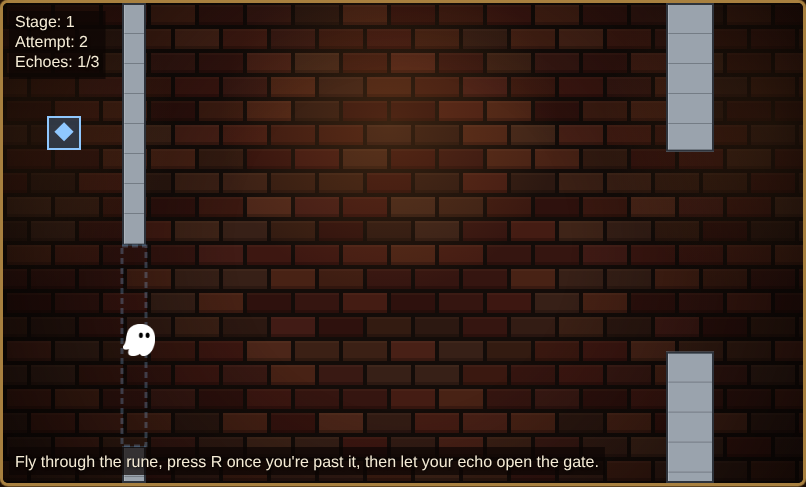

# Ghostly Echoes

A ghost runner where your failures become your teammates. Every time you die or press R to restart, that run turns into an **Echo**: a translucent replay of exactly what you did. Echoes can't die and pass through everything. An Echo that flies over a **rune** holds its linked **gate** open, so the way through a stage is to cooperate with your past self: one run opens the gate, the next run flies through it.

## Screenshots




*The Echo has already left the rune, but the gate stays open for another half second, long enough to fly through.*

## How to play

| Action | Input |
| --- | --- |
| Flap | `Space`, `↑`, click or tap the game |
| Restart and leave an Echo | `R` |

- **Goal:** reach the finish line at the end of the stage without touching a wall, a hazard, a closed gate, or the top or bottom edge.
- **Echoes:** each death or restart is stored as an Echo, up to **3 per stage**. When a 4th is stored, the oldest one disappears. Clearing a stage doesn't create an Echo, and a new stage starts with none.
- **Gates:** each gate has a rune with the same symbol and color. Only an Echo can open it. The gate stays open for half a second after the Echo leaves the rune. Flying over a rune yourself does nothing.

### Stage 1 walkthrough

1. Flap to start. Steer through the openings in the walls.
2. Before the gate, the rune sits in the opposite half of the screen from the gate's opening. Fly through the rune.
3. Once you're past the rune, press `R`. That run becomes your first Echo.
4. On the next attempt, your Echo replays that run right alongside you (Echoes move at the same speed as you). When it crosses the rune, the gate opens. Steer for the gate opening and fly through while it is open.
5. Reach the finish line to load Stage 2. Later stages have tighter gaps, more hazards and up to 3 gates.

## How to run

There's nothing to install and no build step.

- **Locally:** open `index.html` in a browser (it works from `file://`).
- **GitHub Pages:** serve the repository root. All paths are relative.

## How to test

```sh
node --test
```

This needs Node 20 or newer. The tests use only `node:test` and `node:assert`, with no dependencies and no `npm install`. Property tests are seeded and reproducible: set `GE_BASE_SEED` to change the base seed, or `GE_SEED` / `GE_CASE` to rerun a single failing case.

## How it was built with Kiro

The game was built spec-first with [Kiro](https://kiro.dev). The spec lives in `.kiro/specs/ghostly-echoes/`:

- `requirements.md`: what the game must do, as testable acceptance criteria.
- `design.md`: architecture, data models, the stage generator algorithm and the correctness properties.
- `tasks.md`: the implementation plan, executed task by task with a test run before each commit.

Key design decisions:

- **Deterministic fixed-timestep simulation.** The game runs at 60 Ticks per second, separate from the frame rate, using integer fixed-point math. The same inputs always produce the same run, on any machine.
- **Echoes are input logs.** A run is recorded as one flap/no-flap value per Tick, not as positions. Replaying the log through the same simulation reproduces the run exactly.
- **Construction-based stage generation.** Each stage is generated from a seed. The generator first simulates a solution (your runs and the Echoes they need) and then builds the walls, hazards, runes and gates around it. A self-check replays that solution, so every stage is guaranteed to be solvable.

## Project structure

```
src/        Game code (classic scripts that also load in Node)
tests/      node:test suites and the seeded property-test harness
assets/     Ghosty sprite and sound effects
.kiro/      Kiro specs for this project
index.html  Entry point
```

## Credits and licence

The Ghosty sprite (`assets/ghosty.png`) and the sound effects (`assets/jump.wav`, `assets/game_over.wav`) come from the Flappy Kiro starter resources this repository was created from.

Licensed under MIT No Attribution. See [LICENCE.md](LICENCE.md).
